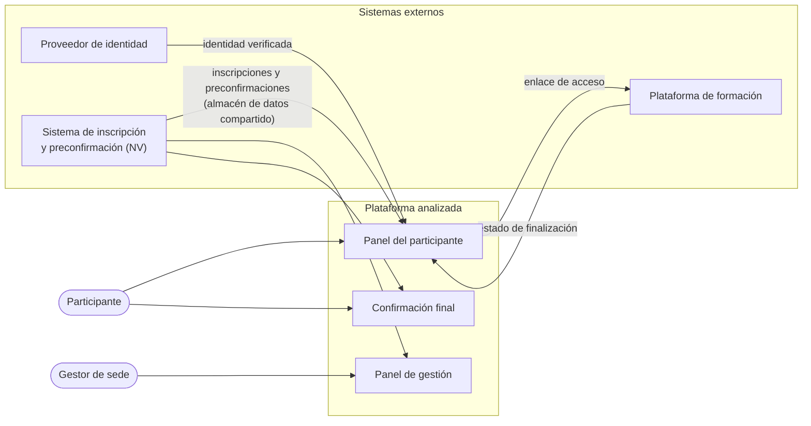
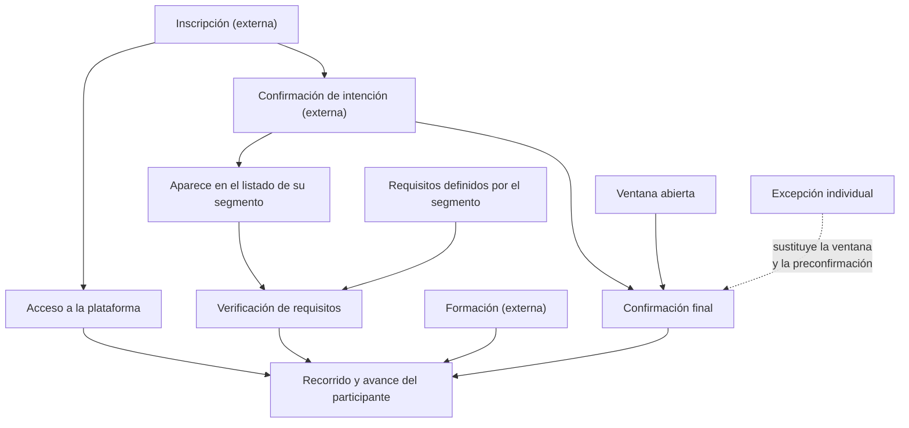
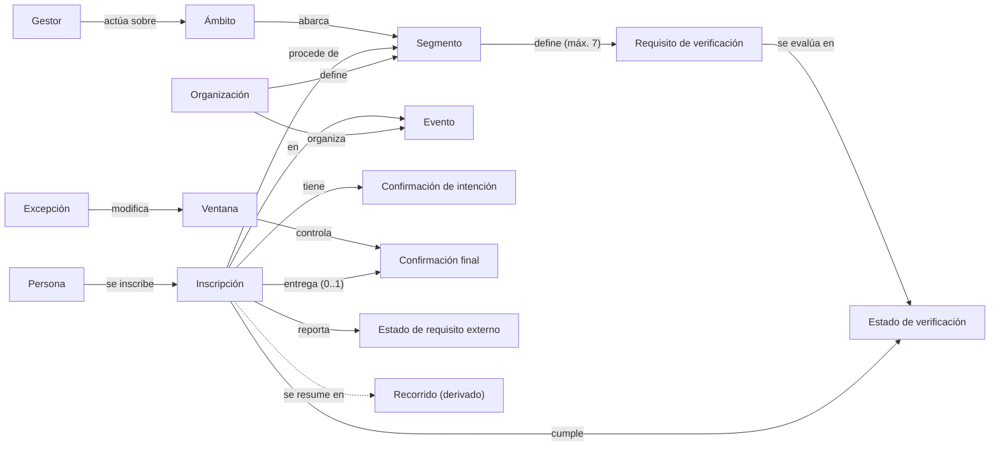
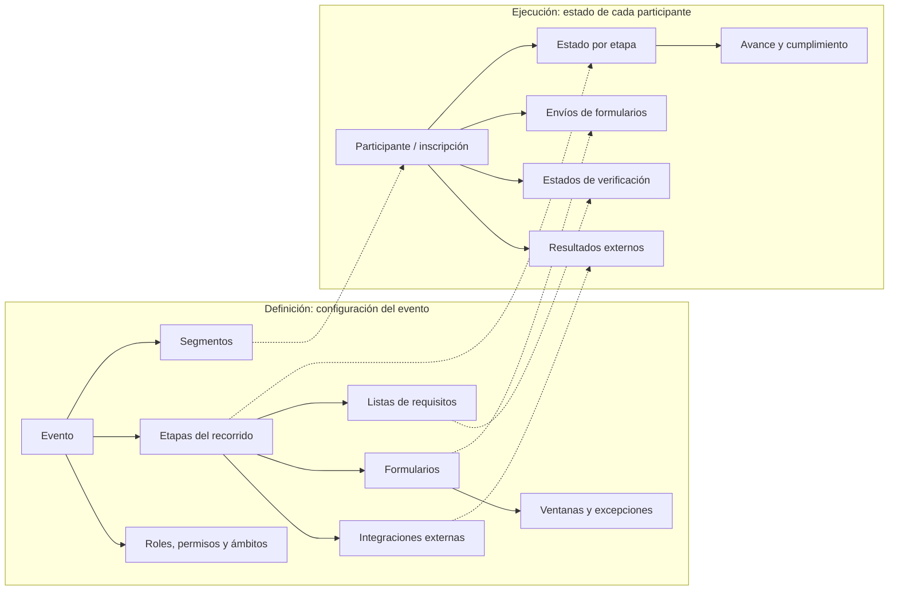

# Abstracción funcional del dominio de gestión de eventos

**Análisis de referencia: plataforma de seguimiento de participantes «Camino ENEUN 2026»**

| | |
|---|---|
| **Objeto analizado** | Aplicación web «Camino ENEUN 2026» contenida en este repositorio: portal del participante y panel de gestión por sede. |
| **Versión analizada** | Código fuente en la revisión `9eef476` (6 de noviembre de 2026) y su historial de cambios. |
| **Método** | Lectura del código fuente, de los textos de la interfaz, de las estructuras de datos que la aplicación usa o documenta y del historial de versiones. No se navegó el sitio publicado ni se accedió a datos reales, a la configuración de producción ni a los sistemas externos. |
| **Fecha** | 6 de noviembre de 2026 |

**Convenciones de evidencia** (se usan en todo el documento):

- **[O] Observado:** comportamiento verificado directamente en el código o en los textos de la plataforma.
- **[D] Deducido:** inferencia razonable a partir de nombres, estructuras de datos, textos o historial, sin confirmación directa.
- **[NV] No verificable:** depende de sistemas, datos o configuraciones externos a los que no se tuvo acceso.

> **Sobre el objeto analizado.** La solicitud se refería a «la página web proporcionada» sin indicar una dirección. Se analizó la aplicación de este repositorio. Disponer del código fuente permitió verificar comportamientos que no son visibles públicamente, como los paneles que exigen autenticación. Aun así, todo lo que depende de sistemas externos o de datos de producción se marca como no verificable.

---

## 1. Introducción y propósito de la abstracción

### 1.1 Propósito

Este documento analiza una plataforma web que acompaña a los participantes de un evento presencial durante las etapas previas a su asistencia. La plataforma también permite a los equipos organizadores, distribuidos por unidades de procedencia, verificar que cada participante cumple los requisitos.

A partir de ese análisis, el documento abstrae sus capacidades en conceptos independientes del evento original. El fin es que sirva de referencia funcional para una futura plataforma de gestión de eventos de propósito general: académicos, culturales, musicales, deportivos, institucionales, empresariales, científicos, entre otros.

### 1.2 Alcance

Incluye:

- qué hace la plataforma, qué problemas atiende y qué procesos soporta;
- actores, permisos y responsabilidades;
- conceptos del dominio y sus relaciones;
- reglas de negocio, datos gestionados e integraciones;
- clasificación de funcionalidades en genéricas, configurables y específicas;
- una propuesta conceptual de núcleo común y módulos opcionales.

No incluye el diseño de una base de datos, de una arquitectura ni de una interfaz, ni la elección de tecnologías. Las referencias a la implementación original se limitan a lo necesario para saber de dónde sale cada afirmación.

### 1.3 Cómo leer el documento

- Las secciones 2 a 11 describen y abstraen la plataforma original.
- La sección 12 identifica qué puede generalizarse y qué capacidades no existen.
- La sección 13 reúne límites, vacíos e incertidumbres del análisis.
- La sección 14 propone el modelo conceptual de una plataforma genérica.

Desde la sección 3 se usan términos generales. La tabla 2.5 relaciona cada término del evento original con su equivalente general.

### 1.4 Síntesis de hallazgos

- La plataforma es, ante todo, un **tablero del recorrido del participante**. Reúne en una sola vista el estado de cinco etapas obligatorias, de las cuales solo una se diligencia dentro de ella; las demás provienen de otros sistemas o de verificaciones hechas por los organizadores.
- La gestión está **descentralizada por segmentos** (las sedes de procedencia). Cada gestor ve y verifica únicamente a los participantes de sus segmentos, con listas de requisitos propias.
- La **confirmación final** es un formulario completo: identificación para la credencial, salud, contacto de emergencia, alojamiento y transporte. Tiene validaciones, precarga de datos, consentimiento, resumen previo y edición posterior, y se controla con una ventana global de apertura y una lista de excepciones.
- La **inscripción, la preconfirmación y la formación previa** ocurren en sistemas externos. La plataforma las integra leyendo directamente sus datos, lo que la acopla fuertemente a ellos.
- **No existen** notificaciones, reportes, exportaciones, credenciales digitales o códigos QR, control de asistencia durante el evento ni procesos de cierre.
- Casi todo el comportamiento está fijado en el código: etapas, catálogos, textos, fechas y límites. Generalizar la plataforma consiste, sobre todo, en convertir esas decisiones en configuración.

---

## 2. Descripción general de la plataforma original

### 2.1 Contexto del evento

- Encuentro estudiantil de alcance nacional organizado por una universidad pública con varias sedes regionales. Se realizó de forma presencial durante tres días (27 a 29 de marzo de 2026) en una ciudad anfitriona. **[O]** (textos de la interfaz)
- Los participantes son estudiantes de las distintas sedes. La sede de procedencia determina quién verifica sus requisitos y qué formulario previo diligenció. **[O]**
- Las estructuras de datos referencian nueve sedes. **[O]** (documentación del esquema incluida en el código)
- Parte de los participantes colabora en comités del equipo organizador; ese dato se muestra en su perfil. **[O]**

### 2.2 Qué es y qué hace la plataforma

La plataforma tiene dos caras:

1. **Portal del participante.** Acceso con cuenta institucional, ficha personal, recorrido de cinco etapas con estado, detalle y fecha, porcentaje de avance, enlace a la plataforma de formación y formulario de confirmación final de asistencia. **[O]**
2. **Panel de gestión por sede.** Los gestores definen hasta siete requisitos por sede, verifican a cada participante de forma individual o masiva, consultan su avance y cumplimiento, y pueden abrir el panel de un participante en modo de vista previa. Un gestor con un privilegio especial controla además la apertura de la confirmación final y su lista de excepciones. **[O]**

Además, la plataforma tiene un modo de mantenimiento global y muestra los contactos de soporte en todas las páginas. **[O]**

### 2.3 Ecosistema en el que opera

### 2.4 Qué queda dentro y fuera de la plataforma

| Capacidad | Ubicación | Evid. |
|---|---|---|
| Autenticación de participantes y gestores | Dentro | O |
| Consolidación del recorrido y cálculo del avance | Dentro | O |
| Confirmación final de asistencia | Dentro; puede sustituirse por un formulario externo configurable | O |
| Definición y verificación de requisitos por sede | Dentro | O |
| Control de la ventana de confirmación y sus excepciones | Dentro | O |
| Vista previa del panel de un participante | Dentro | O |
| Modo mantenimiento | Dentro; lo activa el equipo técnico, no desde la interfaz | O |
| Inscripción («preinscripción») | Sistema externo | O (se leen sus datos) / NV (su funcionamiento) |
| Preconfirmación por sede | Sistema externo | O / NV |
| Formación previa obligatoria | Plataforma externa | O / NV |
| Creación y mantenimiento de cuentas de gestores | Fuera de la interfaz | D |
| Notificaciones, reportes, exportaciones, credenciales, asistencia durante el evento, cierre | No existen | O (ausencia en el código) |

### 2.5 Equivalencias terminológicas

| Término del original | Significado en la plataforma original | Concepto general |
|---|---|---|
| Camino ENEUN | Línea de progreso del participante | Recorrido del participante |
| Sede / sede de origen | Sede de la universidad de la que proviene el estudiante y que lo gestiona | Segmento de procedencia (delegación, capítulo, región, club, empresa, categoría…) |
| Preinscripción | Registro inicial del interesado, en otro sistema | Inscripción |
| Preconfirmación | Manifestación previa de asistencia, por sede, en otro sistema | Confirmación de intención |
| Validación de sede de origen | Lista de requisitos que la sede verifica para cada estudiante | Verificación de requisitos por segmento |
| Validación (de sede) | Cada ítem de esa lista | Requisito de verificación |
| Capacitaciones de la plataforma | Cursos en una plataforma de formación externa | Requisito externo (formación o inducción) |
| Formulario final / Confirmación final de asistencia | Formulario con datos logísticos, de salud y de emergencia | Confirmación final de participación |
| Escarapela | Identificación física que se porta en el evento | Credencial (gafete) |
| EPS | Entidad de salud a la que está afiliada la persona | Aseguradora o entidad de salud |
| Comité donde apoya | Comité del equipo organizador en el que colabora el participante | Equipo de trabajo o voluntariado |
| Acampar / zona de acampada del campus | Modalidad de alojamiento ofrecida en el lugar del evento | Alojamiento provisto por el evento |
| Administrador de sede | Gestor de una o varias sedes | Gestor de segmento |
| Admin Supremo | Gestor con control de la apertura de la confirmación final | Gestor con privilegio de control de ventanas |
| Excepciones | Correos habilitados cuando el formulario está cerrado | Lista de habilitación excepcional |
| Validación masiva («scrap») | Marcar requisitos en bloque pegando listados | Verificación masiva por lista |
| Ver index | Abrir el panel de un participante | Vista previa del panel del participante |

---

## 3. Objetivos y problemas que resuelve

### 3.1 Propósito principal

Ofrecer un punto único donde cada participante conozca su avance en los requisitos para asistir y donde los equipos de cada segmento verifiquen ese cumplimiento. El recorrido termina con la recolección de la información logística y de cuidado que se necesita para ejecutar el evento.

### 3.2 Problemas que aborda

| # | Problema | Cómo lo aborda la plataforma | Evid. |
|---|---|---|---|
| P1 | La información del participante está dispersa en varios sistemas y formularios. | Reúne el estado de todas las etapas en un único panel, con fechas y detalle. | O |
| P2 | El participante no sabe qué le falta para poder asistir. | Muestra el estado de cada etapa con mensajes concretos (p. ej. «Pendiente 0/3», «En curso 2/5»), el porcentaje de avance y un aviso de que debe cumplir todos los pasos. | O |
| P3 | La verificación la hacen equipos distintos según la procedencia del participante. | Gestores por segmento con acceso restringido a sus participantes y listas de requisitos propias. | O |
| P4 | Verificar a muchos participantes uno por uno es costoso. | Verificación masiva pegando listados de correos, documentos o nombres. | O |
| P5 | Antes del evento se necesitan datos logísticos, de salud y de emergencia. | Confirmación final estructurada, con consentimiento para datos sensibles. | O |
| P6 | Hay que controlar el periodo de recolección y atender casos rezagados. | Apertura y cierre global de la confirmación, con excepciones por persona. | O |
| P7 | Personas no autorizadas podrían acceder. | Solo se permiten correos del dominio institucional y personas previamente inscritas. | O |
| P8 | Los datos para la credencial y la identificación deben ser correctos. | Nombre para la credencial con recomendación de longitud y documento corregible por el participante. | O |
| P9 | El equipo necesita dar soporte a los participantes. | Vista previa del panel de un participante y contactos de soporte visibles. | O |
| P10 | Hay que poder responder a incidentes técnicos. | Modo mantenimiento que bloquea el acceso con un mensaje informativo. | O |

### 3.3 Valor por actor

- **Participante:** sabe en todo momento qué etapas cumplió, cuáles le faltan y dónde completarlas; entrega sus datos finales en un solo formulario que puede corregir.
- **Gestor de segmento:** ve solo a sus participantes, define qué debe verificar, marca el cumplimiento de forma individual o masiva y conoce el avance de cada uno.
- **Gestor con privilegio de control:** decide cuándo se recolecta la información final y a quién se le permite entregarla fuera de plazo.
- **Organización:** obtiene datos consolidados y verificados de forma distribuida, sin centralizar todo el trabajo operativo.

---

## 4. Actores y roles

### 4.1 Catálogo de actores

| Actor | Tipo | Cómo se identifica | Responsabilidades | Capacidades | Restricciones | Evid. |
|---|---|---|---|---|---|---|
| Visitante | Persona sin sesión | — | Iniciar el acceso. | Ver la página de acceso con sus mensajes de error y el enlace al acceso de gestores. | No ve ningún dato. | O |
| Participante | Persona inscrita | Cuenta institucional a través del proveedor de identidad | Completar las etapas del recorrido y entregar la confirmación final. | Consultar su ficha y su recorrido, entrar a la formación, diligenciar y actualizar la confirmación final. | Solo accede a sus propios datos. La confirmación final depende de la ventana y de la preconfirmación. | O |
| Gestor de un segmento | Persona del equipo organizador | Usuario y contraseña propios de la plataforma | Definir y verificar los requisitos de su segmento. | Crear y eliminar requisitos, marcar cumplimiento, buscar y filtrar, abrir la vista previa de participantes. | Solo su segmento. | O |
| Gestor multisegmento | Persona del equipo organizador | Igual | Lo mismo, en varios segmentos. | Lo mismo; debe elegir el segmento al crear un requisito. | Solo sus segmentos. | O |
| Gestor global | Persona del equipo organizador | Igual; su cuenta está marcada como global o superior | Supervisión transversal. | Lo mismo, en todos los segmentos. | Ninguna de ámbito. Las dos marcas (global y superior) tienen el mismo efecto observable. | O |
| Gestor con privilegio de control (original: «Admin Supremo») | Gestor con un privilegio adicional | Se reconoce por el nombre o usuario de su cuenta, no por un permiso asignado | Controlar cuándo se recolecta la confirmación final. | Abrir y cerrar globalmente la confirmación final; agregar y quitar excepciones. | El privilegio se suma al ámbito de segmentos que tenga. | O |
| Equipo técnico | Personas que operan la plataforma | Fuera de la plataforma | Operación, configuración y soporte. | Activar el mantenimiento y configurar integraciones y parámetros mediante cambios de configuración que requieren publicar una nueva versión. | No tiene interfaz propia. | O |
| Soporte | Personas de contacto | Datos de contacto en el pie de página | Atender preguntas y problemas. | — | Canal externo (correo). | O |
| Proveedor de identidad | Sistema externo | — | Autenticar a los participantes. | Entrega identificador, correo, nombre e imagen. | — | O |
| Sistema de inscripción y preconfirmación | Sistema externo | — | Registrar inscripciones y preconfirmaciones. | Es la fuente de las personas habilitadas y de su segmento. | Su funcionamiento no es visible desde la plataforma. | O / NV |
| Plataforma de formación | Sistema externo | — | Impartir la formación previa y registrar quién la completó. | Es la fuente del estado de formación. | — | O / NV |

**Nota:** ser miembro de un comité del equipo organizador no es un rol con permisos en la plataforma. Es un atributo del participante que solo se muestra en su ficha. **[O]**

### 4.2 Tipos de actividad

- **Administración:** gestión de cuentas de gestores (fuera de la interfaz **[D]**), control de la ventana de confirmación y de sus excepciones (gestor con privilegio de control **[O]**), modo mantenimiento (equipo técnico **[O]**).
- **Organización:** definición de requisitos por segmento, verificación individual y masiva, seguimiento del cumplimiento (gestores **[O]**).
- **Participación:** entrega de la confirmación final y realización de la formación externa (participante **[O]**). La inscripción y la preconfirmación también son actividades del participante, pero ocurren fuera de esta plataforma **[NV]**.
- **Consulta:** el participante consulta su recorrido y su ficha; los gestores consultan listados, avances y la vista previa de participantes **[O]**.

### 4.3 Matriz de capacidades por rol

| Capacidad | Participante | Gestor de un segmento | Gestor multisegmento | Gestor global |
|---|---|---|---|---|
| Consultar su propia ficha y recorrido | ✓ | — | — | — |
| Diligenciar y actualizar la confirmación final | ✓ (según ventana y prerrequisitos) | — | — | — |
| Consultar el listado de participantes y su avance | — | Su segmento | Sus segmentos | Todos |
| Crear y eliminar requisitos | — | Su segmento | Sus segmentos (eligiendo cuál) | Todos (eligiendo cuál) |
| Marcar requisitos, de forma individual o masiva | — | Su segmento | Sus segmentos | Todos |
| Abrir la vista previa del panel de un participante | — | Su segmento | Sus segmentos | Todos |
| Abrir y cerrar la confirmación final; gestionar excepciones | — | Solo con privilegio de control | Solo con privilegio de control | Solo con privilegio de control |
| Activar el modo mantenimiento | — | — | — | — (lo hace el equipo técnico, fuera de la interfaz) |

El visitante sin sesión solo puede ver la página de acceso.

---

## 5. Funcionalidades y módulos identificados

### 5.1 Mapa de módulos y funcionalidades

**P** = funcionalidad principal; **S** = secundaria. Todas son **[O]** salvo que se indique otra cosa.

**M1. Acceso e identidad**
- F1.1 (P) Autenticación federada del participante con un proveedor de identidad externo, protegida con un valor de estado y un verificador de un solo uso, y con reautenticación obligatoria en cada ingreso.
- F1.2 (P) Restricción del acceso a correos de un dominio institucional.
- F1.3 (P) Comprobación de que la persona está inscrita, tanto al ingresar como en cada carga del panel.
- F1.4 (P) Sesiones firmadas de duración limitada (8 horas), separadas para participantes y gestores.
- F1.5 (P) Autenticación de gestores con usuario y contraseña.
- F1.6 (S) Mensajes de error de acceso que explican la causa: dominio no permitido, persona no inscrita, sesión de autenticación perdida, fallo general o autenticación no disponible.
- F1.7 (S) Redirecciones según el estado de la sesión: con sesión activa, la página de acceso lleva al panel; sin sesión, las páginas privadas llevan a la página de acceso.
- F1.8 (S) Cierre de sesión de participantes y de gestores.

**M2. Panel del participante (autoservicio)**
- F2.1 (P) Ficha del participante: nombre, correo, tipo y número de documento, segmento, unidad académica, si se aloja en el lugar del evento, equipo de trabajo e identificador único.
- F2.2 (P) Recorrido de etapas con estado, detalle y fecha (ver 6.2).
- F2.3 (P) Porcentaje de avance.
- F2.4 (S) Actualización automática del recorrido cada 10 segundos mientras la página está abierta.
- F2.5 (S) Detalle desplegable de la confirmación final ya enviada.
- F2.6 (S) Acceso a la plataforma de formación desde su etapa, en una ventana nueva.
- F2.7 (P) Acceso a la confirmación final, interna o externa según la configuración.
- F2.8 (S) Avisos contextuales: confirmación cerrada o preconfirmación pendiente.
- F2.9 (S) Leyenda de estados.

**M3. Confirmación final de participación**
- F3.1 (P) Control de acceso: ventana de apertura, excepciones y prerrequisito de preconfirmación.
- F3.2 (P) Precarga de datos desde la inscripción, la preconfirmación y el envío anterior.
- F3.3 (P) Cinco bloques: identificación y credencial, salud y bienestar, contacto de emergencia, alojamiento y transporte.
- F3.4 (P) Campos condicionales y opciones excluyentes.
- F3.5 (P) Validación en el navegador y en el servidor, con las mismas reglas.
- F3.6 (S) Recomendación no bloqueante sobre la longitud del nombre para la credencial.
- F3.7 (P) Consentimiento explícito para el tratamiento de datos sensibles.
- F3.8 (S) Resumen en vivo de lo diligenciado, para revisar antes de enviar.
- F3.9 (P) Un único envío por participante, editable: cada reenvío reemplaza el anterior.
- F3.10 (S) Copia legible del envío, guardada junto a los datos estructurados para auditoría.
- F3.11 (S) Aviso de que ya existe un envío previo.

**M4. Verificación de requisitos por segmento**
- F4.1 (P) Definición de requisitos por segmento (máximo siete) y su eliminación, que borra en cascada los estados asociados.
- F4.2 (P) Listado de los participantes preconfirmados del ámbito, con el estado de cada requisito.
- F4.3 (P) Marcado individual (completar o desmarcar) con efecto inmediato en pantalla.
- F4.4 (P) Verificación masiva a partir de una lista pegada.
- F4.5 (P) Cálculo del avance y del cumplimiento de cada participante.
- F4.6 (S) Búsqueda por nombre, documento o correo y filtro por cumplimiento.
- F4.7 (S) Reporte de las líneas que no coincidieron con ningún participante en la verificación masiva.

**M5. Control de la ventana de confirmación**
- F5.1 (P) Apertura y cierre global.
- F5.2 (P) Lista de excepciones: agregar, quitar y consultar.
- F5.3 (S) Consulta de si un correo concreto tiene acceso. El servicio existe, pero la interfaz no lo usa.

**M6. Supervisión y soporte**
- F6.1 (P) Vista previa, de solo lectura, del panel de un participante dentro del ámbito del gestor.
- F6.2 (S) Créditos y contactos de soporte visibles en todas las páginas.

**M7. Integraciones**
- F7.1 (P) Lectura de inscripciones y preconfirmaciones desde un almacén de datos compartido.
- F7.2 (P) Lectura del estado de formación desde el almacén de la plataforma de formación.
- F7.3 (S) Enlace a la página de acceso de la plataforma de formación.
- F7.4 (S) Sustitución opcional de la confirmación final por un formulario externo, al que se le pasa el correo del participante.

**M8. Disponibilidad y parámetros globales**
- F8.1 (S) Modo mantenimiento.
- F8.2 (S) Zona horaria única del evento para todas las fechas mostradas.

### 5.2 Relaciones entre módulos

- **M1** es la puerta de entrada de todo y determina el rol y el ámbito de cada persona.
- **M2** no genera datos propios: agrega la información de M3, M4 y M7 y la presenta como un recorrido.
- **M3** depende de **M5** (ventana y excepciones) y de los datos de preconfirmación que llegan por **M7**. Lo que se envía en M3 se refleja en la ficha de M2, que toma de ahí el documento vigente y el tipo de alojamiento.
- **M4** depende de **M7**, porque solo aparecen los participantes con preconfirmación en el segmento. Su resultado alimenta la tercera etapa del recorrido en M2.
- **M6** reutiliza M2 en un contexto de gestor, acotado por el ámbito definido en M1.
- **M8** está por encima de todos: el mantenimiento los suspende a todos y la zona horaria afecta a todas las fechas.

### 5.3 Trazabilidad con la plataforma original

| Interfaz del original | Tipo | Módulos |
|---|---|---|
| Página de acceso | Pantalla pública | M1 |
| Acceso de gestores | Pantalla pública | M1 |
| Panel del participante | Pantalla con sesión de participante; también se usa como vista previa de gestor | M2, M6 |
| Confirmación final | Pantalla con sesión de participante | M3 |
| Panel de gestión por sede | Pantalla con sesión de gestor | M4, M5, M6 |
| Página de mantenimiento | Pantalla informativa | M8 |
| Servicios de autenticación: iniciar, completar y cerrar | Servicios | M1 |
| Servicio de estado del recorrido | Servicio | M2 |
| Servicio de envío de la confirmación final | Servicio | M3 |
| Servicios de gestión: requisitos, participantes, verificación masiva, ventana | Servicios | M1, M4, M5 |

---

## 6. Procesos y flujos de trabajo

### 6.1 Cobertura del ciclo de vida del evento

| Etapa del ciclo de vida | ¿Presente? | Dónde ocurre | Observaciones | Evid. |
|---|---|---|---|---|
| Planificación | No | — | Las fechas, la ciudad y el lugar están escritos en los textos de la interfaz. | O |
| Configuración | Parcial | Dentro: requisitos por segmento, ventana de confirmación y excepciones, mantenimiento. Fuera: etapas, catálogos y textos fijos en el código; cuentas de gestores. | El sistema externo parece tener configuración propia de fases, preguntas por sede y cierres. | O / D / NV |
| Convocatoria | No | — | — | O |
| Inscripción | Externa | Sistema de inscripción | La plataforma solo la consulta; es condición de acceso. | O / NV |
| Confirmación de intención | Externa | Sistema de preconfirmación, con formularios por sede | Es condición para la verificación por segmento y para la confirmación final. | O / D |
| Selección o aprobación | Parcial | Verificación de requisitos por segmento y formación externa | No hay una decisión explícita de aprobación: el cumplimiento se deduce del estado de las etapas. | O |
| Confirmación de asistencia | Sí | Confirmación final | Controlada por una ventana y una lista de excepciones. | O |
| Ejecución (durante el evento) | No | — | Hubo un intento, después revertido, de mostrar la asistencia por día (ver 13.2). | O (historial) |
| Seguimiento | Sí | Panel del participante y panel de gestión | Abarca solo las etapas previas al evento. | O |
| Cierre | No | — | El único mecanismo de cierre es cerrar la ventana de confirmación. | O |

### 6.2 El recorrido del participante y sus reglas de estado

El recorrido tiene cinco etapas fijas, en un orden fijo. Cada etapa tiene uno de cuatro estados:

| Estado | Significado en la leyenda | Uso observado |
|---|---|---|
| Sin iniciar | Etapa aún bloqueada | No hay inscripción, o la etapa depende de otra que no se ha cumplido. |
| En curso | Actividad activa | La etapa está abierta o avanzando; también se usa cuando se espera una acción de los organizadores. |
| Completado | Revisión aprobada | La condición de la etapa se cumplió. |
| Atención | Acción requerida | Falta una acción concreta. |

| # | Etapa (concepto general) | Fuente de información | Regla de estado | Detalle mostrado | Evid. |
|---|---|---|---|---|---|
| 1 | Inscripción | Inscripción en el almacén compartido | Completado siempre (sin inscripción no se puede ingresar). | «Completado el dd·mm» | O |
| 2 | Confirmación de intención | Fecha de preconfirmación de la inscripción o registro de preconfirmación | Completado si existe; si no, Atención. | «Confirmado el dd·mm» / «Pendiente de preconfirmación» | O |
| 3 | Verificación de requisitos por segmento | Requisitos del segmento del participante y sus estados | Sin iniciar si no hay preconfirmación. En curso si el segmento aún no tiene requisitos («En espera de validaciones»). Completado si cumplió todos. En curso si cumplió algunos («En curso n/m»). Atención si no cumplió ninguno («Pendiente 0/m»). | Conteo n/m | O |
| 4 | Requisito externo (formación) | Estado de finalización en la plataforma de formación | Completado si la formación figura como terminada. En cualquier otro caso En curso, incluso si no hay registro o falla la consulta. | Fecha o invitación a ingresar, con enlace | O |
| 5 | Confirmación final | Existencia de un envío de la confirmación final | Completado si existe; si no, En curso. | Fecha del último envío o «Formulario en curso» | O |

Reglas generales del recorrido:

- Si la persona no tiene inscripción, las cinco etapas aparecen como «Sin iniciar». **[O]**
- El avance es el porcentaje redondeado de etapas completadas sobre el total. **[O]**
- Las fechas se muestran en la zona horaria del evento, con formato día·mes. **[O]**
- La plataforma advierte que quien no cumpla todos los pasos no podrá asistir, pero no calcula ni guarda una decisión de elegibilidad. **[O]**

### 6.3 Flujos detallados

#### PF-01. Acceso del participante

- **Actores:** participante y proveedor de identidad.
- **Precondición:** tener una inscripción registrada con un correo del dominio permitido.
- **Secuencia:**
  1. El visitante solicita acceder desde la página pública. El botón se bloquea mientras se procesa, para evitar solicitudes duplicadas. **[O]**
  2. La plataforma crea un intento de acceso con un valor de estado y un verificador de un solo uso, válidos 10 minutos. Luego redirige al proveedor de identidad pidiendo reautenticación y con la conexión de cuentas institucionales ya seleccionada. **[O]**
  3. El proveedor autentica a la persona y devuelve un código de autorización. **[O]**
  4. La plataforma comprueba que el estado coincide, canjea el código y obtiene el identificador, el correo, el nombre y la imagen. **[O]**
  5. Verifica que el correo pertenezca al dominio permitido y que exista una inscripción con ese correo. **[O]**
  6. Crea la sesión del participante (8 horas) y lo lleva a su panel. **[O]**
- **Salidas:** sesión activa y panel del participante.
- **Excepciones** (se informan en la página de acceso): sesión de autenticación perdida en el proveedor, con explicación de sus causas habituales (varias ventanas de acceso abiertas, recargar durante el ingreso o cambiar de modo en el navegador); fallo de autenticación; dominio no permitido (cierra cualquier sesión previa); persona no inscrita; autenticación no disponible. **[O]**

#### PF-02. Seguimiento del recorrido

- **Actor:** participante. **Precondición:** sesión activa.
- **Secuencia:**
  1. Al abrir el panel se vuelve a verificar la inscripción. Si ya no existe, se cierra la sesión y se informa. **[O]**
  2. Se construyen la ficha y el estado de cada etapa con las fuentes internas y externas (6.2). **[O]**
  3. Se muestran el avance, las etapas con su detalle, la leyenda y el acceso a la confirmación final. El acceso aparece siempre; la ventana se evalúa recién al entrar. **[O]**
  4. Mientras la página está abierta, el estado se vuelve a consultar cada 10 segundos y se actualiza sin recargar. **[O]**
  5. El participante puede desplegar el detalle de su confirmación enviada y abrir la plataforma de formación desde su etapa. **[O]**
- **Salidas:** ficha, recorrido, avance y detalle del envío.

#### PF-03. Confirmación final de participación

- **Actor:** participante.
- **Precondiciones:** sesión activa; ventana abierta o excepción; preconfirmación registrada o excepción.
- **Secuencia:**
  1. Al entrar se evalúa la ventana. Si está cerrada y la persona no figura en la lista de excepciones, vuelve al panel con un aviso de cierre. **[O]**
  2. Se evalúa la preconfirmación. Si no existe y la persona no es una excepción, vuelve al panel con un aviso. **[O]**
  3. Se precargan los datos:
     - de identificación: nombre legal, correo, identificador y segmento, no editables; el documento sí se puede corregir;
     - derivados de la inscripción y la preconfirmación: nombre para la credencial, alergias y tipo de alojamiento;
     - si existe un envío anterior, todas sus respuestas, con un aviso de que puede actualizarlas. **[O]**
  4. El participante completa los cinco bloques. Los campos de detalle aparecen solo para las condiciones que seleccione, y la dirección se fija sola si elige el alojamiento provisto por el evento. **[O]**
  5. Un resumen se actualiza en vivo para revisar antes de enviar. **[O]**
  6. Al enviar se validan los datos. Los errores se muestran junto a cada campo, acompañados de un mensaje general. **[O]**
  7. El servidor vuelve a comprobar la sesión, la ventana, la excepción y la preconfirmación. Después normaliza y valida los datos y guarda el envío, creándolo o reemplazando el anterior, junto con la fecha de envío en la inscripción, en una sola operación. **[O]**
  8. Se confirma el guardado y el participante vuelve al panel, donde la etapa aparece completada con su fecha. **[O]**
- **Entradas:** ver 10.2.
- **Salidas:** envío guardado (datos estructurados y copia legible) y etapa completada.
- **Excepciones:** sesión vencida; ventana cerrada mientras se diligenciaba (se rechaza el envío); preconfirmación ausente; datos inválidos; inscripción sin identificador único; persona sin inscripción (solo puede pasar con una excepción); error interno. **[O]**

#### PF-04. Acceso de gestores

- **Secuencia:**
  1. El gestor ingresa su usuario y contraseña.
  2. Se verifican contra el registro de gestores.
  3. Se determina su ámbito (segmentos asignados o global) y su etiqueta (el nombre de su segmento, «Multisede» o «Global»).
  4. Se crea la sesión (8 horas) y se abre el panel de gestión. **[O]**
- **Excepciones:** credenciales incompletas o inválidas, con un mensaje genérico que no revela qué dato falló. **[O]**
- **No existen** el autorregistro, la recuperación de contraseña ni la gestión de cuentas desde la interfaz. **[O]**

#### PF-05. Definición de requisitos del segmento

- **Crear:** el nombre es obligatorio (hasta 120 caracteres). Quien gestiona varios segmentos debe elegir uno. Hay un tope de siete requisitos por segmento: la interfaz deshabilita la creación al llegar al tope y el servidor la rechaza. No se impide repetir nombres. **[O]**
- **Eliminar:** se pide confirmación, advirtiendo que se borrará el estado de ese requisito para todos los participantes. El requisito y sus estados se eliminan juntos. **[O]**
- **Efecto:** cambia el total de requisitos del segmento y, con él, el avance, el cumplimiento y la tercera etapa del recorrido de todos sus participantes. **[O]**

#### PF-06. Verificación individual

- El gestor marca o desmarca un requisito para un participante y el cambio se ve de inmediato. El servidor comprueba que el participante y el requisito sean del mismo segmento y que el gestor tenga ámbito sobre él. Si algo falla, se restaura el estado real y se informa del error. **[O]**
- Los requisitos de otros segmentos aparecen como «no aplica» para ese participante. **[O]**
- El participante ve el cambio en su recorrido en la siguiente actualización automática. **[O]**

#### PF-07. Verificación masiva por lista

- **Secuencia:**
  1. El gestor pega un texto con una persona por línea (normalmente copiado de una hoja de cálculo) y elige el requisito.
  2. Cada línea se normaliza: si contiene un correo, se usa solo el correo; si no, se eliminan los caracteres no válidos.
  3. Se buscan coincidencias solo entre los participantes del segmento del requisito: documento exacto (ignorando los puntos de miles), correo contenido en la línea, nombre completo, o nombre y apellido presentes. La comparación no distingue mayúsculas ni tildes.
  4. Si ninguna línea coincide, se avisa y no se envía nada.
  5. Las coincidencias se marcan como completadas. El servidor descarta a quien no pertenezca al segmento.
  6. Se informa cuántos participantes se validaron y se listan las líneas sin coincidencia (hasta 50 visibles). El resultado se ve durante 15 segundos. **[O]**
- **Restricciones:** la operación solo marca, no desmarca; acepta hasta 5.000 participantes; cada línea se asocia, como máximo, con el primer participante que coincida. **[O]**

#### PF-08. Consulta, búsqueda y filtrado

- El listado incluye a los participantes del ámbito, ordenados por apellido y nombre. De cada uno se muestran el nombre, el documento, el segmento (si el gestor tiene varios), el estado de cada requisito, el porcentaje de avance, si cumple, y el acceso a su vista previa. **[O]**
- La búsqueda es por nombre, documento o correo, sin distinguir tildes, y se ejecuta al confirmarla. El filtro permite ver todos, los que cumplen o los que no cumplen. Un contador indica cuántos se muestran de cuántos hay. **[O]**

#### PF-09. Vista previa del panel del participante

- El gestor elige ver el panel de un participante. Se comprueba la sesión del gestor y que el participante pertenezca a un segmento de su ámbito; si no, vuelve al panel de gestión. **[O]**
- El panel se muestra marcado como vista previa y con estas diferencias:
  - no se actualiza automáticamente;
  - no ofrece el cierre de sesión del participante ni el acceso a la confirmación final;
  - incluye un enlace para volver al panel de gestión. **[O]**
- La vista previa incluye el detalle de la confirmación final, con datos de salud y de emergencia. **[O]**
- Si en el mismo navegador hay también una sesión de participante, la vista previa tiene prioridad cuando se solicita. **[O]**

#### PF-10. Control de la ventana de confirmación y de las excepciones

- **Actor:** gestor con privilegio de control.
- **Secuencia:**
  1. Consulta el estado (abierta o cerrada) y la lista de excepciones (se muestran las 150 más recientes).
  2. Abre o cierra la ventana globalmente.
  3. Agrega un correo a las excepciones. Se guarda en minúsculas y no se comprueba que corresponda a una inscripción.
  4. Quita un correo de las excepciones. Cada acción muestra un mensaje de resultado. **[O]**
- **Efecto:** inmediato sobre PF-03. Una excepción permite acceder con la ventana cerrada y además exime del requisito de preconfirmación. **[O]**

#### PF-11. Cierre de sesión

- Tanto el participante como el gestor terminan su sesión y vuelven a la página de acceso. Esto no cierra la sesión en el proveedor de identidad, pero el siguiente acceso exige autenticarse de nuevo. **[O]**

#### PF-12. Modo mantenimiento

- **Actor:** equipo técnico. Se activa con un cambio de configuración que requiere publicar una nueva versión.
- **Efecto:** todas las pantallas redirigen a una página de mantenimiento dirigida a participantes y administradores, y los servicios responden que no están disponibles. **[O]**

### 6.4 Comunicación, notificación, control y seguimiento

- **Comunicación:** solo ocurre dentro de la plataforma. **[O]** Los canales son:
  - el detalle de cada etapa;
  - los avisos contextuales y los mensajes de error;
  - la advertencia sobre el cumplimiento de todos los pasos;
  - la recomendación sobre el nombre para la credencial;
  - el texto de consentimiento;
  - la página de mantenimiento;
  - los contactos de soporte en el pie de página.

  La inscripción recoge un número de mensajería y la autorización para usarlo **[O: esquema]**, lo que sugiere que hay comunicación por ese canal fuera de la plataforma **[D]**.
- **Notificación:** no hay notificaciones proactivas (correo, mensajería o avisos push). La «actualización en tiempo real» consiste en consultar el estado cada 10 segundos. **[O]**
- **Control:**
  - restricciones de acceso: dominio, inscripción, ventana, excepciones y preconfirmación;
  - ámbitos de gestión;
  - topes: requisitos por segmento y tamaño de la verificación masiva;
  - validación de datos en el navegador y en el servidor;
  - confirmación antes de las acciones destructivas;
  - modo mantenimiento. **[O]**
- **Seguimiento:**
  - el participante sigue su propio avance;
  - el gestor ve el avance y el cumplimiento por participante.

  No hay indicadores agregados ni historial de cambios: solo se guarda la fecha de la última modificación de cada estado o envío. **[O]**

### 6.5 Dependencias entre procesos

| # | Dependencia | Evid. |
|---|---|---|
| D1 | Sin inscripción no hay acceso. | O |
| D2 | Sin preconfirmación, el participante no aparece en el listado de su segmento, no puede ser verificado y su etapa de verificación queda «sin iniciar». | O |
| D3 | La etapa de verificación no puede completarse mientras el segmento no tenga requisitos definidos. | O |
| D4 | La confirmación final exige preconfirmación y ventana abierta, salvo que la persona sea una excepción. | O |
| D5 | La formación es independiente de las demás etapas y solo afecta a la suya. | O |
| D6 | La confirmación final **no** depende de la verificación por segmento ni de la formación: se puede entregar sin haberlas completado. | O |
| D7 | La confirmación final actualiza la ficha: el documento vigente y el alojamiento. | O |

---

## 7. Entidades y conceptos fundamentales

> Esto es un mapa conceptual del dominio, no un modelo de datos. Los nombres son generales; entre paréntesis se indica el equivalente original cuando sirve para entender el origen.

### 7.1 Conceptos del dominio

| Concepto | Descripción | Información y responsabilidades | Relaciones principales | Alcance | Evid. |
|---|---|---|---|---|---|
| Organización anfitriona | Entidad que organiza el evento y de la que proceden los participantes | Define los segmentos y el dominio de identidad permitido | Tiene segmentos y eventos | General | D (implícita) |
| Evento | Encuentro con fecha, lugar y zona horaria | Nombre, edición, ciudad, fechas, lugar, textos | Tiene participantes, segmentos y recorrido | General | O (implícito: no es una entidad gestionable, está fijado en textos) |
| Segmento de procedencia (sede) | Agrupación de participantes que también es unidad de gestión | Nombre; tiene requisitos propios y, fuera de la plataforma, formularios de preconfirmación propios | Agrupa inscripciones; es el ámbito de los gestores | General (configurable) | O |
| Persona / participante | Quien asiste al evento | Nombres, apellidos, correo, documento, unidad académica | Tiene una o más inscripciones | General | O |
| Inscripción | Vínculo de la persona con el evento | Identificadores estables (uno numérico, compartido con otros sistemas, y un identificador único visible), fecha, segmento, respuestas | Tiene preconfirmaciones, verificaciones, una confirmación final y un estado de formación | General | O |
| Confirmación de intención (preconfirmación) | Manifestación previa de asistencia | Fecha, segmento, respuestas (incluye tipo de alojamiento y equipo de trabajo) y, en el esquema, la intención declarada | Pertenece a una inscripción y a un segmento | Configurable | O (uso) / NV (proceso) |
| Etapa del recorrido | Paso que el participante debe cumplir | Nombre, orden, fuente de información, regla de estado | Define el recorrido | General | O (fijo en el código) |
| Estado de etapa | Resultado de evaluar una etapa para un participante | Estado, detalle y fecha | Se calcula a partir de otras entidades | General | O |
| Requisito de verificación (validación de sede) | Condición que el segmento verifica para cada participante | Nombre, segmento, fecha de creación | Pertenece a un segmento | General | O |
| Estado de verificación | Cumplimiento de un requisito por un participante | Cumplido o no, fecha de la última actualización | Une inscripción y requisito, como máximo uno por par | General | O |
| Confirmación final (envío) | Respuestas finales del participante | Un envío por inscripción, con fechas de creación y modificación y una copia legible | Pertenece a una inscripción | General como mecanismo; contenido específico | O |
| Datos de salud y cuidado | Información sensible para atención durante el evento | Condiciones, detalles, grupo sanguíneo, entidad de salud y consentimiento | Forman parte del envío | Opcional (sensible) | O |
| Contacto de emergencia | Persona a quien avisar | Nombre, parentesco y teléfono | Forma parte del envío | Configurable | O |
| Logística de alojamiento | Dónde se alojará el participante | Modalidad y dirección; existe una modalidad provista por el evento | Forma parte del envío; determina un atributo de la ficha | Configurable | O |
| Logística de transporte | Cómo se movilizará el participante | Compromiso de usar el transporte provisto o medios propios | Forma parte del envío | Configurable | O |
| Credencial | Identificación que se porta en el evento | Nombre para la credencial, pronombres e identificador único | Forma parte del envío y de la inscripción | Configurable | O (datos) / D (la credencial se produce fuera) |
| Equipo de trabajo (comité) | Equipo del organizador en el que colabora el participante | Uno o varios nombres de equipo | Atributo de la inscripción, tomado de la preconfirmación | Configurable | O |
| Gestor | Cuenta administrativa | Usuario, nombre, credencial, segmentos asignados, marcas global y superior | Tiene un ámbito y, quizá, un privilegio de control | General | O |
| Ámbito de gestión | Conjunto de segmentos sobre los que actúa un gestor | Uno, varios o todos | Relaciona gestores con segmentos | General | O |
| Ventana de acceso | Estado de apertura de la confirmación final | Abierta o cerrada, fecha de actualización; cerrada por defecto | Controla el acceso al envío | General | O |
| Excepción | Persona habilitada fuera de la ventana | Correo y fecha | Modifica el efecto de la ventana y del prerrequisito | General | O |
| Requisito externo (formación) | Condición que se cumple en otro sistema | Completado o no y fecha | Pertenece a una inscripción | Configurable (integración) | O |
| Catálogos | Listas de opciones de los formularios | Condiciones de salud, pronombres, parentescos, modalidades de alojamiento, grupos sanguíneos y transporte | Usados por la confirmación final | Configurable | O |
| Sesión | Acceso autenticado vigente | Identidad, rol y vencimiento | Pertenece a un participante o a un gestor | General (técnico) | O |
| Estado de disponibilidad | Si la plataforma está operativa | Activo o en mantenimiento | Afecta a todo | General | O |

### 7.2 Relaciones entre conceptos

En resumen:

- Una persona puede tener varias inscripciones; la plataforma usa la más reciente. **[O]**
- Una inscripción puede tener varias preconfirmaciones; se toma la más reciente. **[O]**
- Cada segmento define sus requisitos, y cada participante tiene como máximo un estado por requisito. **[O]**
- Una inscripción tiene como máximo una confirmación final. **[O]**
- Los gestores se relacionan con los segmentos a través de su ámbito. **[O]**
- El recorrido no se almacena: se calcula cada vez a partir de las demás entidades. **[O]**

### 7.3 Conceptos derivados

| Concepto derivado | Cómo se obtiene | Evid. |
|---|---|---|
| Segmento de referencia del participante | El de su preconfirmación más reciente; si no tiene, el de su inscripción. | O |
| Documento de identidad vigente | El de la confirmación final si existe; si no, el de la inscripción. | O |
| Alojamiento en el lugar del evento | Por orden de prioridad: confirmación explícita en el envío final → modalidad elegida en el envío final → respuesta de la preconfirmación → tipo de entrada de la inscripción, reconocido por patrones de texto. | O |
| Equipo de trabajo | Respuestas de la preconfirmación, descartando las negativas; si no hay, «sin equipo asignado». | O |
| Cumplimiento de verificación | Todos los requisitos del segmento cumplidos, con al menos uno definido. | O |
| Avance del recorrido | Porcentaje de etapas completadas. | O |
| Elegibilidad para asistir | Se comunica como «cumplir todas las etapas», pero no se calcula ni se guarda. | O |

### 7.4 Conceptos generales frente a conceptos condicionados por el evento original

**Generales:** evento, segmento, persona, inscripción, recorrido y etapas, estado de etapa, requisito y estado de verificación, envío de formulario, ventana y excepción, gestor y ámbito, sesión, catálogos, disponibilidad.

**Condicionados por el evento original:**

- que el segmento sea una sede universitaria y que el acceso exija un dominio de correo institucional;
- la modalidad de alojamiento en una zona de acampada del campus anfitrión, con dirección fija;
- el compromiso de usar un transporte provisto por la universidad;
- la entidad de salud propia del sistema de salud nacional;
- la credencial física («escarapela»);
- los comités del equipo organizador;
- la representación estudiantil en cuerpos colegiados (solo aparece en el esquema);
- la formación en una plataforma concreta;
- el tope de siete requisitos, las cinco etapas fijas y las fechas del evento escritas en los textos.

---

## 8. Clasificación de funcionalidades

### 8.1 Genéricas (aplicables a casi cualquier evento)

| Funcionalidad | Por qué es genérica |
|---|---|
| Autenticación de participantes con un proveedor de identidad | Todo evento con datos personales necesita identificar a sus participantes. |
| Acceso condicionado a una inscripción previa | Restringe el acceso a quien realmente participa. |
| Sesiones y cierre de sesión, separados por tipo de usuario | Es necesaria en cualquier plataforma con roles. |
| Panel del participante con recorrido de etapas, estados y avance | Todo evento con requisitos previos se beneficia de mostrar al participante su situación. |
| Actualización automática del estado | Mejora la percepción de inmediatez en procesos con verificación externa. |
| Gestores con ámbito por segmento | La gestión descentralizada (delegaciones, sedes, equipos) es común. |
| Listado, búsqueda y filtrado de participantes por cumplimiento | Es la operación básica de cualquier organizador. |
| Verificación individual de requisitos | Lista de chequeo por participante, útil en cualquier evento. |
| Verificación masiva a partir de una lista | Los organizadores suelen trabajar con hojas de cálculo. |
| Vista previa del panel de un participante | Es una herramienta transversal de soporte. |
| Ventanas de apertura con excepciones individuales | Todo proceso con plazo tiene rezagados. |
| Formulario con validación en dos niveles, precarga, resumen previo y edición posterior | Es el mecanismo base de recolección de datos. |
| Consentimiento para el tratamiento de datos | Es una exigencia legal frecuente. |
| Modo mantenimiento | Continuidad operativa. |
| Zona horaria del evento para las fechas | Todo evento ocurre en un lugar y un huso horario. |
| Mensajes de error explicativos y avisos contextuales | Calidad de la interacción. |

### 8.2 Configurables (su comportamiento varía según el evento)

| Funcionalidad | Qué varía | Valor en el original |
|---|---|---|
| Restricción de acceso por dominio | Ninguna, uno o varios dominios | Un dominio institucional |
| Proveedor y conexión de identidad | Proveedor, conexión preseleccionada, reautenticación obligatoria | Conexión de cuentas institucionales, con reautenticación siempre |
| Etapas del recorrido | Cantidad, orden, nombres, fuente y regla de estado de cada una | Cinco etapas fijas |
| Dependencias entre etapas | Qué etapa bloquea a cuál | La verificación depende de la preconfirmación; la confirmación final también |
| Segmentos | Denominación, lista, jerarquía | Sedes |
| Tope de requisitos por segmento | Número | 7 |
| Prerrequisitos de la confirmación final | Qué etapas se exigen antes | Preconfirmación |
| Efecto de las excepciones | Solo la ventana, o también los prerrequisitos | Ambos |
| Edición posterior del envío | Permitida o bloqueada | Permitida (el historial muestra que al principio estaba bloqueada) |
| Secciones y campos de la confirmación final | Qué datos se piden y cuáles son obligatorios | Credencial, salud, emergencia, alojamiento y transporte |
| Catálogos de opciones | Contenido de cada lista | Seis catálogos fijos |
| Opciones excluyentes y campos condicionales | Reglas entre campos | «Ninguna» y «Prefiero no responder» excluyentes; detalle por condición |
| Recomendaciones no bloqueantes | Umbrales y textos | Nombre de credencial de 3 o más palabras o de más de 18 caracteres |
| Criterios de la verificación masiva | Campos de coincidencia y tolerancia | Documento, correo y nombre |
| Formulario externo en lugar del interno | Dirección y parámetros | Opcional, se le pasa el correo |
| Frecuencia de actualización automática | Intervalo | 10 segundos |
| Duración de las sesiones | Tiempo | 8 horas |
| Privilegio de control de ventanas | A quién se asigna | Se reconoce por el nombre de la cuenta |
| Textos institucionales, fechas y contactos de soporte | Contenido | Fijos en el código |

### 8.3 Específicas (propias del evento original)

| Funcionalidad | Necesidad que atiende | Tratamiento propuesto |
|---|---|---|
| Alojamiento en la zona de acampada del lugar del evento, con dirección fija | Logística de alojamiento masivo en el lugar | Opción del módulo de logística: «alojamiento provisto por el evento», con dirección configurable |
| Compromiso de uso responsable del transporte provisto | Logística de movilidad y corresponsabilidad | Módulo opcional de transporte con compromisos configurables |
| Entidad de salud, grupo sanguíneo y detalle de condiciones de salud | Atención médica durante un evento presencial con estancia | Módulo opcional de salud y cuidado, con controles de privacidad reforzados |
| Equipo de trabajo tomado de las respuestas de la preconfirmación | Identificar a quienes también colaboran en la organización | Módulo opcional de equipos o voluntariado, con asignación propia |
| Integración con una plataforma de formación concreta | Formación obligatoria previa | Adaptador genérico de requisitos externos |
| Alojamiento deducido del tipo de entrada por patrones de texto | Compatibilidad con datos heredados | No llevar al núcleo; resolver con atributos derivados configurables |
| Privilegio supremo reconocido por el nombre de la cuenta | Restringir una acción crítica a una persona | Sustituir por un permiso explícito asignable |
| Sedes, fechas, ciudad y textos institucionales fijos | Contexto del evento | Configuración del evento |
| Representación estudiantil en cuerpos colegiados (solo en el esquema) | Identificar representantes | Atributo configurable del perfil de inscripción |
| Formularios de preconfirmación separados por sede (deducido del esquema) | Preguntas distintas por segmento | Formularios configurables por segmento dentro de un motor común |

---

## 9. Reglas de negocio identificadas

La columna **Generalización** indica el parámetro que una plataforma genérica debería exponer.

**A. Acceso y sesión**

| ID | Regla | Evid. | Generalización |
|---|---|---|---|
| RN-01 | Solo pueden acceder como participantes las personas cuyo correo pertenece al dominio institucional permitido. | O | Lista de dominios permitidos (o ninguna restricción) |
| RN-02 | Solo pueden acceder personas con una inscripción previa con ese correo, sin distinguir mayúsculas ni espacios. | O | Exigir o no inscripción previa |
| RN-03 | La inscripción se vuelve a verificar al cargar el panel; si ya no existe, la sesión se invalida. | O | Revalidación periódica de la elegibilidad |
| RN-04 | Cada acceso exige autenticarse de nuevo ante el proveedor de identidad. | O | Política de reautenticación |
| RN-05 | Un intento de acceso caduca a los 10 minutos. | O | Vigencia del intento |
| RN-06 | Las sesiones de participante y de gestor duran 8 horas y son independientes entre sí. | O | Duración de sesión por rol |
| RN-07 | Los gestores usan usuario y contraseña registrados por la organización; no hay autorregistro ni recuperación de contraseña. | O | Métodos de autenticación de gestores |

**B. Ámbitos y permisos**

| ID | Regla | Evid. | Generalización |
|---|---|---|---|
| RN-08 | Un gestor marcado como global o superior actúa sobre todos los segmentos; si no, solo sobre los asignados (uno o varios). | O | Ámbito por gestor |
| RN-09 | Los segmentos se comparan sin distinguir mayúsculas, tildes ni espacios sobrantes. | O | Identificador canónico de segmento |
| RN-10 | Un gestor solo ve y modifica participantes, requisitos y estados de su ámbito. | O | Autorización por ámbito |
| RN-11 | Quien gestiona varios segmentos debe elegir uno al crear un requisito; quien gestiona uno solo crea en el suyo. | O | — |
| RN-12 | Solo el gestor con privilegio de control puede abrir o cerrar la confirmación final y gestionar excepciones. | O | Permiso explícito |
| RN-13 | La vista previa de un participante solo está disponible dentro del ámbito del gestor y es de solo lectura. | O | Permiso de vista previa |

**C. Recorrido**

| ID | Regla | Evid. | Generalización |
|---|---|---|---|
| RN-14 | El recorrido tiene cinco etapas fijas en un orden fijo, cuyos estados siguen las reglas de la sección 6.2. | O | Etapas, orden y reglas configurables |
| RN-15 | El avance es el porcentaje redondeado de etapas completadas sobre el total. | O | Ponderación de etapas |
| RN-16 | Las fechas se muestran en la zona horaria del evento (GMT−5), con formato día·mes. | O | Zona horaria y formato por evento |
| RN-17 | La fecha de la etapa de confirmación final es la de la última modificación del envío. | O | Primera fecha o última fecha |
| RN-18 | El segmento de referencia para la verificación es el de la preconfirmación más reciente; si no la hay, el de la inscripción. | O | Fuente del segmento |
| RN-19 | La preconfirmación cuenta como hecha si existe un registro o una fecha, sin importar la intención declarada (asistirá o no). | O / D | Criterio de completitud por etapa |
| RN-20 | Si no se puede obtener el estado de la formación, la etapa se muestra «en curso». | O | Comportamiento ante fallos de una integración |
| RN-21 | La plataforma advierte que incumplir cualquier etapa impide asistir, pero no registra una decisión de elegibilidad. | O | Regla de elegibilidad explícita |

**D. Verificación por segmento**

| ID | Regla | Evid. | Generalización |
|---|---|---|---|
| RN-22 | Cada segmento puede tener como máximo siete requisitos. | O | Tope configurable |
| RN-23 | El nombre del requisito es obligatorio (hasta 120 caracteres); se permiten nombres repetidos. | O | Unicidad de nombres |
| RN-24 | Eliminar un requisito elimina todos sus estados, previa confirmación. | O | Política de borrado (cascada o archivo) |
| RN-25 | Solo los participantes con preconfirmación en el segmento aparecen en el listado y pueden verificarse para sus requisitos. | O | Población verificable |
| RN-26 | Un participante cumple cuando todos los requisitos de su segmento están cumplidos y existe al menos uno. | O | Regla de cumplimiento |
| RN-27 | La verificación masiva solo marca como cumplido, trata cada línea por separado y la asocia con el primer participante que coincida. | O | Modos de operación masiva |
| RN-28 | La coincidencia masiva se hace por documento exacto (ignorando los separadores de miles), correo, nombre completo, o nombre y apellido, sin distinguir tildes. | O | Criterios de coincidencia |
| RN-29 | Una operación masiva acepta como máximo 5.000 participantes. | O | Tope configurable |

**E. Confirmación final**

| ID | Regla | Evid. | Generalización |
|---|---|---|---|
| RN-30 | La confirmación final tiene una ventana global, cerrada por defecto. | O | Ventanas por formulario o segmento, programables |
| RN-31 | Las personas en la lista de excepciones acceden con la ventana cerrada y quedan exentas de la preconfirmación. | O | Alcance de las excepciones |
| RN-32 | Sin excepción, la confirmación final exige una preconfirmación previa. | O | Prerrequisitos por formulario |
| RN-33 | Hay un único envío por participante. Reenviar lo reemplaza: se conserva la fecha de creación, se actualiza la de modificación y no se guarda historial de versiones. | O | Política de edición y versiones |
| RN-34 | Son obligatorios: documento, nombre para la credencial, pronombres (y su texto si se elige «otro»), al menos una condición de salud («ninguna» por defecto), el detalle de cada condición seleccionada, la entidad de salud, el consentimiento, el contacto de emergencia completo, la modalidad de alojamiento y el transporte. Son opcionales el grupo sanguíneo y la dirección de alojamiento. | O | Obligatoriedad por campo |
| RN-35 | «Ninguna» y «Prefiero no responder» excluyen cualquier otra condición; si se desmarca todo, vuelve a «Ninguna». | O | Grupos de opciones excluyentes |
| RN-36 | El teléfono de emergencia debe tener entre 7 y 20 caracteres: dígitos, «+» y espacios. | O | Patrones por campo |
| RN-37 | Si se elige el alojamiento provisto por el evento, la dirección se asigna automáticamente y no se puede editar. | O | Valores dependientes |
| RN-38 | Se recomienda, sin obligar, acortar el nombre para la credencial si tiene 3 o más palabras o más de 18 caracteres. | O | Recomendaciones no bloqueantes |
| RN-39 | El servidor limita la longitud de cada texto: documento 64; nombre para la credencial, segmento, nombre y parentesco de emergencia, alojamiento y entidad de salud 120; pronombre 40 (60 si es «otro»); detalles de salud 500; grupo sanguíneo 20; teléfono 40; dirección 240. | O | Longitudes por campo |
| RN-40 | El nombre legal, el correo, el identificador único y el segmento provienen de la inscripción y no se pueden editar. El documento sí, y el corregido es el que se muestra. | O | Campos bloqueados y su fuente |
| RN-41 | Se precargan el primer nombre como nombre para la credencial, las alergias de la inscripción y el alojamiento de la preconfirmación. | O | Mapeo de precarga |
| RN-42 | Las excepciones se identifican por correo, guardado en minúsculas, sin comprobar que esté inscrito. | O | Validar o no contra las inscripciones |

**F. Disponibilidad**

| ID | Regla | Evid. | Generalización |
|---|---|---|---|
| RN-43 | En modo mantenimiento, todas las pantallas redirigen a la página de mantenimiento y los servicios rechazan las solicitudes. | O | Mantenimiento por evento o por módulo, activable en caliente |

---

## 10. Información, datos y documentos gestionados

### 10.1 Grupos de información

| Grupo | Contenido | Origen | Uso en la plataforma | Sensibilidad | Quién accede | Evid. |
|---|---|---|---|---|---|---|
| Identidad | Nombres, apellidos, correo, tipo y número de documento, identificadores | Inscripción (externa) | Acceso, ficha, coincidencias de la verificación masiva | Personal | El participante; los gestores de su ámbito | O |
| Datos académicos | Segmento y unidad académica; en el esquema, también carrera y semestre | Inscripción | Ficha y segmentación | Personal | Igual | O / NV |
| Datos ampliados de inscripción | Teléfono, mensajería y su autorización, discapacidad y ajustes razonables, preferencias alimentarias, alergias, representación estudiantil, sugerencias, respuestas abiertas, tipo de entrada | Inscripción | Solo se usan las alergias (precarga) y el tipo de entrada (alojamiento deducido) | Personal, en parte sensible | — | O (uso) / NV (resto) |
| Preconfirmación | Fecha, segmento, respuestas (alojamiento, equipo de trabajo); en el esquema, la intención declarada | Externo | Recorrido, ficha, listado de gestión, precarga | Personal | El participante; los gestores | O / NV |
| Verificación | Requisitos por segmento y su estado por participante | Interno | Recorrido, gestión | Operativa | El participante (resumen n/m); los gestores (detalle) | O |
| Formación | Completada o no, y fecha | Externo | Recorrido | Operativa | El participante | O |
| Confirmación final | Credencial, pronombres, salud, emergencia, alojamiento, transporte, consentimiento y copia legible | Interno | Ficha, detalle, recorrido | **Sensible** (salud) | El participante; los gestores de su ámbito, a través de la vista previa | O |
| Control de acceso | Estado de la ventana y lista de excepciones con fechas | Interno | Acceso a la confirmación final | Operativa | Gestor con privilegio de control | O |
| Cuentas de gestión | Usuario, nombre, contraseña, ámbito y marcas | Interno, mantenido fuera de la interfaz | Autenticación y autorización | Credenciales | Equipo técnico | O / D |

### 10.2 Información recolectada en la confirmación final

| Campo (concepto general) | Tipo | Obligatorio | Regla | Precarga | Evid. |
|---|---|---|---|---|---|
| Documento de identidad | Texto | Sí | Máx. 64 | Documento de la inscripción | O |
| Segmento | Solo lectura | — | — | Inscripción | O |
| Identificador único | Solo lectura | — | — | Inscripción | O |
| Correo | Solo lectura | — | — | Inscripción | O |
| Nombre para la credencial | Texto | Sí | Máx. 120; recomendación de longitud | Primer nombre | O |
| Nombre legal | Solo lectura | — | — | Inscripción | O |
| Condiciones de salud | Selección múltiple (15 opciones, 2 excluyentes) | Sí («ninguna» por defecto) | Exclusividad | Envío previo | O |
| Detalle por condición (13 posibles) | Texto largo | Si se selecciona la condición | Máx. 500 | Alergias desde la inscripción | O |
| Pronombres | Selección (4 opciones) y texto libre si se elige «otro» | Sí | Máx. 40 / 60 | Envío previo | O |
| Grupo sanguíneo | Selección (8 opciones) | No | — | Envío previo | O |
| Entidad de salud | Texto libre | Sí | Máx. 120 | Envío previo | O |
| Consentimiento de datos sensibles | Casilla | Sí | Debe aceptarse | Envío previo | O |
| Nombre del contacto de emergencia | Texto | Sí | Máx. 120 | Envío previo | O |
| Parentesco | Selección (7 opciones) | Sí | — | Envío previo | O |
| Teléfono del contacto | Texto | Sí | Patrón de 7 a 20 caracteres | Envío previo | O |
| Modalidad de alojamiento | Selección (3 opciones, una provista por el evento) | Sí | — | Preconfirmación o envío previo | O |
| Dirección del alojamiento | Texto | No; fija si el alojamiento lo provee el evento | Máx. 240 | Envío previo | O |
| Transporte | Selección (2 opciones con texto de compromiso) | Sí | — | Envío previo | O |
| Confirmación explícita de alojamiento en el lugar | — | — | Existe en el modelo de datos, pero la interfaz no la pide | — | O |

### 10.3 Documentos, salidas e indicadores

**Existentes** **[O]**:

- Panel del recorrido con ficha, estados, avance y detalle del envío (consulta en pantalla).
- Resumen previo al envío de la confirmación final.
- Copia legible de cada envío, con etiquetas comprensibles (por ejemplo, el texto completo del compromiso de transporte y «Sí/No» en el consentimiento), guardada para auditoría.
- Reporte en pantalla de la verificación masiva: cuántos se validaron y qué líneas no coincidieron.
- Listado de gestión con el avance y el cumplimiento de cada participante.
- Indicadores:
  - porcentaje de avance del participante;
  - conteo n/m de requisitos;
  - porcentaje de avance por participante en la gestión;
  - indicador de cumplimiento;
  - contador de resultados mostrados;
  - número de excepciones.

**No existen** (ausencia comprobada en el código) **[O]**:

- documentos generados (PDF, constancias, certificados);
- códigos QR o credenciales digitales. Sí se recogen el nombre para la credencial y un identificador único visible, lo que sugiere que la credencial se produce fuera de la plataforma **[D]**;
- exportaciones a archivo. La única entrada masiva es pegar texto;
- estadísticas agregadas, tableros o reportes por segmento;
- notificaciones por correo o mensajería.

### 10.4 Consideraciones sobre datos sensibles

- Para guardar los datos de salud hace falta un consentimiento explícito, acompañado de un aviso de que la información es sensible. **[O]**
- Esos datos se guardan dos veces: como campos estructurados y dentro de la copia legible. **[O]**
- Los gestores pueden verlos a través de la vista previa, dentro de su ámbito. No se identificó un control más fino de quién accede a ellos ni un registro de esos accesos. **[O]**
- No se identificaron políticas de conservación ni de eliminación de los datos después del evento. **[NV]**

---

## 11. Interacciones e integraciones con otros sistemas

### 11.1 Integraciones

| Sistema | Función | Dirección | Mecanismo | Datos | Acoplamiento | Evid. |
|---|---|---|---|---|---|---|
| Proveedor de identidad | Autenticar participantes | Entrante | Protocolo estándar de autorización federada, con estado y verificador de un solo uso; conexión preseleccionada; reautenticación obligatoria | Identificador, correo, nombre, imagen | Bajo (protocolo estándar) | O |
| Sistema de inscripción y preconfirmación | Fuente de las personas habilitadas, sus segmentos y sus respuestas previas | Entrante (solo lectura) | Lectura directa de un almacén de datos compartido | Inscripciones, preconfirmaciones y sus respuestas | Alto (depende de estructuras ajenas) | O (lectura) / NV (sistema) |
| Plataforma de formación | Fuente del estado de formación; destino del enlace de acceso | Entrante (lectura) y saliente (enlace) | Lectura directa de su almacén, usando el identificador numérico de la inscripción como clave común; enlace a su página de acceso | Completado o no, y fecha | Alto | O |
| Formulario externo (opcional) | Reemplazar la confirmación final interna | Saliente | Enlace a una dirección configurable a la que se añade el correo del participante | Correo | Bajo | O |
| Hojas de cálculo | Entrada de listados para la verificación masiva | Entrante (manual) | Copiar y pegar texto | Correos, documentos, nombres | Ninguno | O |
| Correo, mensajería, pagos, calendario, mapas, almacenamiento de archivos, interfaces programáticas públicas | — | — | No se identificaron | — | — | O (ausencia) |

### 11.2 Servicios funcionales expuestos

| Servicio | Actor | Entradas | Salidas | Restricciones | Evid. |
|---|---|---|---|---|---|
| Iniciar acceso | Visitante | — | Redirección al proveedor de identidad | — | O |
| Completar acceso | Proveedor y visitante | Código de autorización y estado | Sesión, o un error explicado | Estado válido, dominio, inscripción | O |
| Cerrar sesión del participante | Participante | — | Fin de la sesión | — | O |
| Consultar el estado del recorrido | Participante | Sesión | Etapas con estado, detalle y fecha | Sesión de participante | O |
| Enviar la confirmación final | Participante | Datos del formulario | Resultado y fecha de envío | Ventana o excepción, preconfirmación, validación | O |
| Acceso de gestor | Gestor | Usuario y contraseña | Sesión | — | O |
| Cerrar sesión del gestor | Gestor | — | Fin de la sesión | Disponible aunque la sesión haya vencido | O |
| Consultar requisitos | Gestor | — | Requisitos de su ámbito | Ámbito | O |
| Crear requisito | Gestor | Nombre y, si gestiona varios, segmento | Requisito creado | Ámbito, tope, longitud | O |
| Eliminar requisito | Gestor | Identificador | Confirmación | Ámbito | O |
| Consultar participantes | Gestor | — | Participantes de su ámbito con sus estados | Ámbito | O |
| Verificación individual | Gestor | Participante, requisito, nuevo estado | Confirmación | Mismo segmento, ámbito | O |
| Verificación masiva | Gestor | Lista de participantes y requisito | Cantidad actualizada | Ámbito, segmento, tope | O |
| Consultar la ventana | Gestor con privilegio | Correo (opcional) | Estado, excepciones y, si se indicó un correo, si tiene acceso | Privilegio de control | O |
| Actualizar la ventana o las excepciones | Gestor con privilegio | Nuevo estado y/o correo con «permitir» o «quitar» | Estado y excepciones actualizados | Privilegio de control | O |

Sin una sesión válida, los servicios rechazan la solicitud con un error y las pantallas redirigen al acceso que corresponda. **[O]**

### 11.3 Patrones de interacción usuario–sistema

- **Autoservicio con consulta periódica:** el panel del participante se actualiza solo cada 10 segundos. **[O]**
- **Actualización optimista con reversión:** el marcado individual se refleja al instante y se deshace si el servidor lo rechaza. **[O]**
- **Confirmación de acciones destructivas:** eliminar un requisito pide confirmación explícita. **[O]**
- **Prevención de envíos duplicados:** los botones se deshabilitan mientras se procesa. **[O]**
- **Validación en dos niveles:** en el navegador y en el servidor, con las mismas reglas. **[O]**
- **Precarga, resumen y edición:** se reduce el esfuerzo de diligenciar y se permite corregir. **[O]**
- **Redirecciones con aviso:** cuando se niega el acceso a una pantalla, se vuelve a la anterior explicando por qué. **[O]**
- **Retroalimentación por campo:** los mensajes de error aparecen junto a cada dato, con un resumen general. **[O]**

---

## 12. Oportunidades de generalización

### 12.1 Oportunidades

| ID | En el original | Generalización propuesta |
|---|---|---|
| OG-01 | Cinco etapas fijas en el código | **Recorrido configurable** por evento: etapas con tipo, orden, dependencias, criterio de completitud y fuente de información. |
| OG-02 | Cada etapa tiene una lógica a medida | **Catálogo de tipos de etapa** reutilizables: inscripción, formulario, verificación por lista, requisito externo, confirmación final y, a futuro, asistencia (ver 14.6). |
| OG-03 | «En curso» significa a la vez «espera a la organización» y «el participante debe actuar» | **Modelo de estados homogéneo** que distinga quién debe actuar, con estados como «bloqueada», «no aplica» o «vencida» cuando correspondan. |
| OG-04 | El segmento es una sede universitaria | **Segmentación genérica**: dimensiones de agrupación configurables (delegación, categoría, equipo, región, empresa) y, si se necesita, jerárquicas. |
| OG-05 | La confirmación final está programada a mano | **Motor de formularios configurable**: secciones, campos, tipos, catálogos, exclusividades, condiciones, precargas, consentimientos, longitudes, resumen y política de edición. El esquema externo sugiere que el sistema de preconfirmación ya tenía un banco de preguntas por fase y sede **[NV]**. |
| OG-06 | Una sola ventana global con excepciones | **Ventanas por formulario, etapa o segmento**, programables con fechas, con mensaje de cierre propio y excepciones con alcance definido. En el esquema externo hay rastros de cierres con mensaje y ventanas para rezagados **[NV]**. |
| OG-07 | Privilegio reconocido por el nombre de la cuenta | **Permisos explícitos y asignables**, combinables con ámbitos. |
| OG-08 | Verificación masiva que solo marca | **Herramienta de importación y coincidencia** con previsualización, resolución de ambigüedades, opción de marcar y desmarcar, criterios configurables y reporte conservable. |
| OG-09 | Requisitos con solo un nombre | **Requisitos con más información**, como descripción, responsable o fecha límite, si el evento lo requiere (no observado en el original). |
| OG-10 | La verificación se usa antes del evento | **Verificación durante la ejecución**: requisitos por día o por sesión para controlar la asistencia. El intento revertido del original reutilizaba exactamente este mecanismo (ver 13.2). |
| OG-11 | El alojamiento en el lugar se deduce de cuatro fuentes con prioridad fija | **Atributos derivados configurables** en el perfil, con prioridad de fuentes declarada. |
| OG-12 | Las integraciones leen directamente almacenes ajenos | **Adaptadores de integración** (identidad, formación u otras plataformas externas, formularios externos) con contratos explícitos. |
| OG-13 | Vista previa sin registro | **Vista previa o suplantación de solo lectura** como herramienta de soporte, con registro de accesos. |
| OG-14 | Mantenimiento activado con una nueva publicación | **Disponibilidad configurable en caliente**, por evento, por módulo o por segmento. |
| OG-15 | Un único evento implícito | **Varios eventos y ediciones** dentro de una misma organización, y varias organizaciones. |
| OG-16 | Textos, fechas, ciudad, contactos y zona horaria fijos | **Parametrización** del contenido institucional, la zona horaria y el idioma. |
| OG-17 | Datos de salud dentro de un formulario general | **Módulo de salud opcional** con consentimiento, minimización de datos y visibilidad por rol. |

### 12.2 Brechas: capacidades que no tiene la plataforma original

Estas capacidades **no existen** en la plataforma analizada. Se mencionan solo porque las etapas del ciclo de vida que no se cubren (6.1) hacen previsible que una plataforma general las necesite. No describen el comportamiento del original.

- Notificaciones y comunicaciones salientes.
- Reportes, indicadores agregados y exportaciones.
- Credenciales digitales y registro de asistencia en el lugar.
- Registro de auditoría de las acciones de gestión.
- Gestión de cuentas de gestores desde la interfaz.
- Inscripción y confirmación de intención integradas en la propia plataforma.
- Cierre del evento (constancias, evaluación).
- Historial de versiones de los envíos.

---

## 13. Limitaciones, aspectos no identificados y supuestos

### 13.1 Limitaciones del análisis

- No se indicó una URL; se analizó el código de este repositorio en la revisión `9eef476`. Esa versión puede no coincidir con la publicada: incluye correcciones recientes, como la vista previa de participantes, la elección de segmento para gestores multisegmento y el cálculo del avance por segmento.
- No se accedió a datos reales, a la configuración de producción ni a los sistemas externos.
- Lo que se dice de los sistemas externos se deduce solo de las estructuras que la plataforma lee o documenta.

### 13.2 Aspectos no identificados o no verificables

- **Qué significan los requisitos de verificación.** Cada segmento los define libremente y no tienen descripción. El historial muestra una funcionalidad, revertida el mismo día, que interpretaba requisitos con nombres de día o fecha («día 1», «27 de marzo», «viernes») como asistencia diaria al evento. Es decir, al menos en algún momento se planeó usarlos durante la ejecución. **[O: historial]**
- **Reglas de la inscripción y la preconfirmación.** Solo se conocen por los nombres de sus estructuras de datos **[NV]**:
  - un banco de preguntas con tipo, opciones, restricciones, fase y sede;
  - estados de fase globales y por sede;
  - una configuración de cierre con mensaje propio y un «modo de correo abierto»;
  - una ventana en horas para inscripciones tardías y una marca de «tardío» en la inscripción;
  - excepciones al cierre;
  - una tabla de respuestas por pregunta;
  - tablas de preconfirmación separadas por sede, con la intención de asistir;
  - un registro de «días de asistencia» en la inscripción.
- **Otros esquemas presentes.** Hay referencias a usuarios, sesiones, organizaciones, membresías e invitaciones cuyo uso no se observa en la plataforma; podrían pertenecer a otro sistema del ecosistema. **[NV]**
- **Ámbitos de gestores.** Existe una estructura documentada para asignar segmentos a gestores que la plataforma no usa: usa en su lugar una lista guardada en la propia cuenta. **[O]**
- **Ciclo de vida de las cuentas de gestores:** cómo se crean, modifican o desactivan. **[NV]**
- **Uso posterior de los datos:** cómo se producen las credenciales y la logística, y cómo se conservan o eliminan los datos. **[NV]**
- **Proceso de formación:** contenidos, criterios de aprobación y cómo se marca como completada. **[NV]**

### 13.3 Inconsistencias y residuos observados

- La intención declarada en la preconfirmación (asistirá o no) no se tiene en cuenta: basta con que exista el registro. **[O]**
- Existe un aviso de «el formulario ya fue diligenciado» que nada activa hoy. Es un residuo de cuando no se permitía reenviar. **[O: código e historial]**
- La confirmación explícita de alojamiento en el lugar existe en el modelo de datos, pero la interfaz no la pide. **[O]**
- Hay un catálogo de entidades de salud definido pero sin usar: la entidad se escribe como texto libre. **[O]**
- La precarga del alojamiento solo funciona si el valor de la preconfirmación coincide literalmente con una opción del formulario final, y los valores conocidos de la preconfirmación no coinciden (difieren en el texto o en mayúsculas). **[D]**
- Al mostrar el detalle del envío en el panel, las condiciones de salud distintas de «ninguna» y «prefiero no responder» aparecen con su código técnico en lugar de su nombre. **[O]**
- El privilegio de control depende del nombre de la cuenta y no de un permiso. **[O]**
- La fecha de la etapa de confirmación final es la de la última modificación, no la del primer envío. **[O]**
- Hubo una función de acceso alternativo con usuario institucional y número de documento que nunca se conectó a ninguna pantalla; se eliminó en la versión analizada. **[O: historial]**
- Las fechas del evento, la ciudad, la dirección de la zona de acampada y el enlace a la formación están escritos directamente en el código. **[O]**

### 13.4 Supuestos de interpretación

- «Sede» es la sede universitaria de procedencia, que además es la unidad de gestión.
- «Escarapela» es la credencial física; «EPS» es la entidad de salud; «comité» es una comisión del equipo organizador; «capacitaciones» es la formación obligatoria previa al evento.
- Los requisitos de verificación son condiciones que el segmento confirma antes del evento (con la salvedad de 13.2).
- Los sistemas de inscripción y de formación son distintos de la plataforma analizada y los opera la misma organización.

---

## 14. Propuesta de abstracción conceptual de una plataforma genérica de gestión de eventos

> Es una propuesta de dominio, no un diseño técnico. Define qué capacidades y conceptos debería tener la plataforma, no cómo implementarlos.

### 14.1 Visión

Una plataforma que acompañe a los participantes, y a quienes los gestionan, a lo largo de un **recorrido configurable de etapas** que va de la inscripción al cierre, con **gestión descentralizada por segmentos** y con módulos que se activan según el tipo de evento.

### 14.2 Principios

1. **El recorrido como eje:** todo lo que el participante debe cumplir se expresa como etapas con estado.
2. **Separar definición y ejecución:** la configuración del evento (qué se exige) va aparte del estado de cada participante (qué cumplió).
3. **Fuente de información explícita por etapa:** interna (formulario, verificación) o externa (integración).
4. **Gestión por ámbitos:** cada gestor actúa sobre los segmentos que le corresponden.
5. **Configuración antes que código:** textos, fechas, catálogos, topes y reglas son parámetros del evento.
6. **Núcleo pequeño y módulos opcionales:** lo específico de un tipo de evento no entra en el núcleo.
7. **Privacidad por diseño:** consentimiento, mínimo de datos y visibilidad por rol para la información sensible.
8. **Trazabilidad:** quién cambió qué y cuándo, como mínimo en verificaciones y ventanas (el original solo guarda la fecha del último cambio).

### 14.3 Núcleo común

| Capacidad del núcleo | Contenido | Origen en la plataforma original |
|---|---|---|
| N1. Eventos y ediciones | Datos del evento, fechas, lugar, zona horaria, textos institucionales, contactos de soporte | Implícito en textos fijos |
| N2. Identidad y acceso | Proveedores de identidad configurables, reglas de elegibilidad (dominio, inscripción previa), sesiones por rol | M1 |
| N3. Roles, permisos y ámbitos | Gestores con ámbito por segmento o global; permisos explícitos (p. ej. controlar ventanas) | M1, M5 |
| N4. Segmentación | Segmentos configurables; asignación de participantes y gestores | Sedes |
| N5. Participantes e inscripciones | Perfil, identificador estable, atributos derivados con prioridad de fuentes | Ficha del participante |
| N6. Recorrido | Definición de etapas, dependencias, reglas de estado, avance; panel del participante con actualización automática | M2 |
| N7. Formularios | Motor configurable con validación en dos niveles, precarga, consentimiento, resumen, política de edición, ventanas y excepciones | M3, M5 |
| N8. Verificación de requisitos | Listas por segmento, marcado individual y masivo, regla de cumplimiento | M4 |
| N9. Gestión y supervisión | Listados, búsqueda, filtros, vista previa del participante | M4, M6 |
| N10. Operación | Disponibilidad o mantenimiento, mensajes del sistema | M8 |

### 14.4 Módulos opcionales

| Módulo | Qué aporta | Evidencia en el original |
|---|---|---|
| MO1. Logística de alojamiento | Modalidades, dirección, alojamiento provisto por el evento | Observado |
| MO2. Logística de transporte | Opciones de movilidad y compromisos | Observado |
| MO3. Salud, cuidado y emergencia | Condiciones con detalle, entidad de salud, grupo sanguíneo, contacto de emergencia, consentimiento reforzado | Observado |
| MO4. Credencial e identidad visible | Nombre para la credencial con recomendaciones, pronombres, identificador visible | Observado (la credencial se produce fuera) |
| MO5. Equipos de trabajo o voluntariado | Pertenencia a equipos de la organización | Observado (tomado de la preconfirmación) |
| MO6. Requisitos externos | Adaptadores para estados de completitud en otras plataformas (formación u otras) | Observado (formación) |
| MO7. Formularios externos | Reemplazar un formulario interno por uno externo identificando al participante | Observado |
| MO8. Confirmación de intención por segmento | Formularios previos con preguntas propias de cada segmento | Deducido del esquema |
| MO9. Representación o delegaciones formales | Atributos de representación en el perfil | Deducido del esquema |
| MO10. Asistencia durante la ejecución | Verificaciones por día o por sesión | Intento revertido (historial) |

Las capacidades de 12.2 (notificaciones, reportes, credenciales digitales, cierre, entre otras) serían módulos nuevos sin antecedente en el original.

### 14.5 Modelo conceptual: definición y ejecución

- **Definición:** lo que la organización configura antes de abrir el evento y ajusta durante él.
- **Ejecución:** lo que se acumula por cada participante. El recorrido y el avance son vistas calculadas sobre la ejecución, según la definición.

### 14.6 Tipos de etapa y modelo de estados

| Tipo de etapa | Criterio de completitud | Fuente | Ejemplo en el original |
|---|---|---|---|
| Inscripción | Existe la inscripción | Interna o externa | Preinscripción (externa) |
| Formulario | Existe un envío válido | Interna o externa | Preconfirmación (externa); confirmación final (interna) |
| Verificación por requisitos | Todos los requisitos del segmento cumplidos | Interna (gestores) | Validación de sede |
| Requisito externo | El sistema externo informa que está completado | Externa | Formación |
| Asistencia | Verificaciones por día o sesión durante el evento | Interna | Intento revertido |

Cada etapa debería declarar:

- su **dependencia**, es decir, qué etapa la bloquea. En el original, la verificación y la confirmación final dependen de la preconfirmación;
- su **regla de estado**, que traduce sus datos a un estado común: sin iniciar o bloqueada, en curso, requiere atención, completada (y, si conviene, no aplica);
- su **ventana**, si la tiene, y sus **excepciones**;
- su **peso** en el avance (en el original, todas pesan igual).

### 14.7 Dimensiones de configuración de un evento

| Dimensión | En el original |
|---|---|
| Elegibilidad de acceso | Dominio institucional e inscripción previa |
| Proveedor de identidad | Federado, con reautenticación obligatoria |
| Segmentos | Nueve sedes |
| Etapas y su orden | Cinco, fijas |
| Dependencias entre etapas | Verificación y confirmación final requieren preconfirmación |
| Tope de requisitos por segmento | 7 |
| Ventanas | Una global para la confirmación final, cerrada por defecto |
| Excepciones | Por correo; eximen de la ventana y de la preconfirmación |
| Edición de envíos | Permitida, sin historial |
| Campos de la confirmación final | Credencial, salud, emergencia, alojamiento, transporte |
| Catálogos | Fijos |
| Actualización automática del panel | 10 segundos |
| Duración de las sesiones | 8 horas |
| Zona horaria | GMT−5 |
| Contenido institucional | Textos, fechas, ciudad y contactos fijos |
| Mantenimiento | Global, activado con una nueva publicación |

### 14.8 La plataforma original como una configuración del modelo

Para comprobar que el modelo es suficiente, la plataforma original se puede expresar como una configuración suya:

| Elemento del modelo | Configuración que reproduce el original |
|---|---|
| Evento | Encuentro nacional de tres días en una ciudad anfitriona, con zona horaria GMT−5 |
| Elegibilidad | Correo de un dominio institucional y existencia de inscripción |
| Segmentos | Sedes de procedencia |
| Etapa 1 | Inscripción, fuente externa |
| Etapa 2 | Formulario de confirmación de intención, fuente externa |
| Etapa 3 | Verificación por requisitos del segmento (máx. 7); depende de la etapa 2 |
| Etapa 4 | Requisito externo de formación |
| Etapa 5 | Formulario interno de confirmación final; depende de la etapa 2 salvo excepción; ventana global; edición permitida |
| Módulos activos | Alojamiento (con alojamiento provisto), transporte, salud y emergencia, credencial, equipos de trabajo, requisito externo de formación |
| Roles | Gestor de un segmento, multisegmento y global; permiso de control de ventanas asignado a un único gestor |
| Operación | Mantenimiento global |

Ningún elemento del original queda fuera del modelo. Lo que el modelo añade (permisos explícitos, ventanas por etapa, tipos de etapa reutilizables, atributos derivados configurables) responde a las rigideces identificadas en las secciones 12 y 13.

### 14.9 Siguientes pasos

1. Convertir el núcleo (14.3) y los módulos (14.4) en **requisitos funcionales y casos de uso**, priorizando el recorrido configurable, el motor de formularios y la verificación por segmentos.
2. Resolver las **decisiones abiertas** de dominio:
   - si los segmentos son jerárquicos o de varias dimensiones;
   - si se gestionan varios eventos y organizaciones a la vez;
   - qué política de versiones tienen los envíos;
   - qué alcance tienen las excepciones;
   - cómo se tratan los datos sensibles.
3. Definir los **contratos de integración** para identidad y requisitos externos antes de elegir una arquitectura.
4. Cubrir las **brechas** de 12.2 que se consideren parte del núcleo, como notificaciones, reportes y asistencia.
